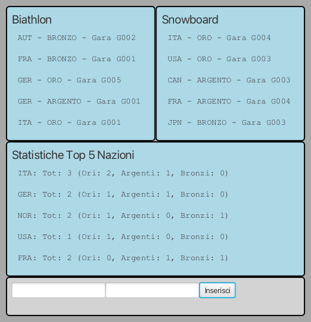
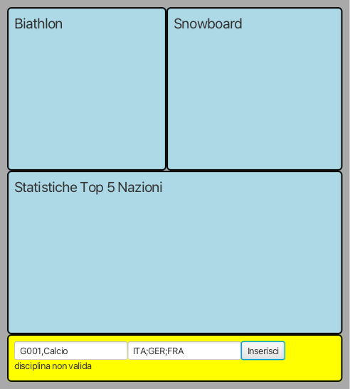
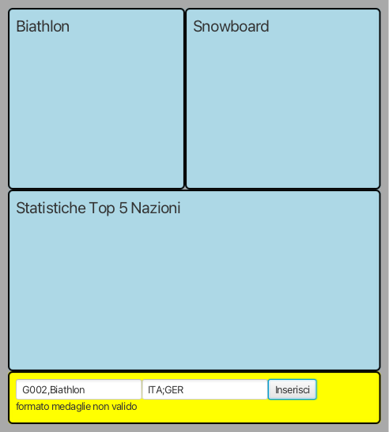
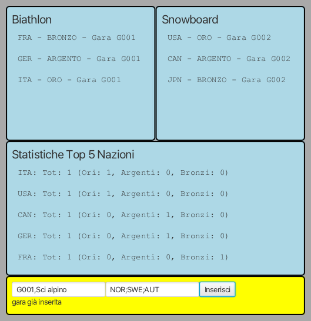

# CORSO INGEGNERIA DEL SOFTWARE A.A. 2025/26

## Appello 18 febbraio 2026

Ogni studente effettua il **fork** di questo repository e
 concede i **permessi di lettura** ai docenti (`carlo.bellettini` e `mattia.monga`).

## Sistema di gestione del medagliere delle Olimpiadi Invernali

Si vuole realizzare un'applicazione Java per la gestione del medagliere delle Olimpiadi invernali. Il sistema deve permettere di registrare i risultati delle gare e fornire statistiche utili per visualizzare le medaglie vinte dalle diverse nazioni nelle varie discipline sportive.

Vengono già fornite due *Viste*:

- [`InputEsitoGara`](src/main/java/it/unimi/di/sweng/esame/view/InputEsitoGara.java): mette a disposizione due caselle di testo
  per immettere i dati di una gara (vedi sotto).
- [`DisplayView`](src/main/java/it/unimi/di/sweng/esame/view/DisplayView.java): permette di visualizzare un elenco di righe di testo.

Viene fornita anche una prima versione della classe  [`Main`](src/main/java/it/unimi/di/sweng/esame/Main.java) che
permette d'istanziare la parte statica delle viste, e di una
interfaccia [`InputPresenter`](src/main/java/it/unimi/di/sweng/esame/presenter/InputPresenter.java).

**TUTTE LE CLASSI DATE POSSONO ESSERE DA VOI MODIFICATE (CANCELLATE, COMPLETATE) PER ADERIRE A VOSTRE IDEE DI
PROGETTAZIONE**

## TRACCIA

Completare, in modo da realizzare un'organizzazione del sistema di tipo
*Model-View-Presenter*, aggiungendo le classi necessarie affinché:

- La vista di immissione dei risultati delle gare permetta di inserire:
  - nel primo campo l'ID della gara e la disciplina sportiva separati da ',' (p.es. "G001,Biathlon" oppure "Slalom Gigante Donne,Sci alpino").
    Le discipline ammesse sono: Biathlon, Bob, Combinata nordica, Curling, Hockey su ghiaccio, Pattinaggio di figura, Pattinaggio di velocità, Salto con gli sci, Sci acrobatico, Sci alpinismo, Sci alpino, Sci di fondo, Short track, Skeleton, Slittino, Snowboard.
  - nel secondo campo i vincitori delle medaglie nel formato: NAZ_ORO;NAZ_ARGENTO;NAZ_BRONZO (p.es. ITA;GER;FRA).
    Ogni parte può contenere più nazioni separate da virgola in caso di pari meriti (p.es. ITA;SWE,NOR; significa oro all'Italia, e argento a pari merito Svezia e Norvegia), in totale i ; sono sempre 2.
    Le nazioni devono essere indicate con sigle di tre caratteri maiuscole (p.es. ITA, GER, FRA, SUI, USA, CAN, JPN, CHN, NOR, SWE, etc.).

  **IMPORTANTE**: A causa delle regole olimpiche sui pari meriti, sono ammesse solo le seguenti configurazioni:
  - 1 ORO, 1 ARGENTO, 1 o più BRONZI (standard: `ITA;GER;FRA` oppure con pari meriti al bronzo: `ITA;GER;FRA,SUI`)
  - 1 ORO, 2 o più ARGENTI, nessun BRONZO (pari merito al secondo posto: `ITA;GER,FRA;`)
  - 2 ORI, nessun ARGENTO, 1 o più BRONZI (pari merito al primo posto: `ITA,GER;;FRA`)
  - 3 o più ORI, nessun ARGENTO, nessun BRONZO (pari merito totale al primo posto: `ITA,GER,FRA;;`)

- Una vista riporti l'elenco delle prime 5 medaglie vinte nel "Biathlon" ordinate per nazione (ordine alfabetico) e, a parità di nazione, per tipo medaglia (ORO, ARGENTO, BRONZO).

- Una vista riporti l'elenco delle prime 5 medaglie vinte nello "Snowboard" ordinate per tipo medaglia (ORO, ARGENTO, BRONZO) e, a parità di tipo, per nazione (ordine alfabetico).

- Una vista riporti le statistiche delle prime 5 nazioni nel medagliere, mostrando per ciascuna:
  - Sigla della nazione
  - Numero totale di medaglie
  - Numero di medaglie d'oro
  - Numero di medaglie d'argento
  - Numero di medaglie di bronzo

  Le nazioni devono essere ordinate mettendo per prime quelle con più ori, a parità di ori quelle con più argenti, a parità di argenti quelle con più bronzi, a parità di medaglie totali in ordine alfabetico.

Il formato delle scritte nelle viste può essere ricavato dalle figure sotto riportate.

Dovranno inoltre essere segnalati i principali errori (di alcuni c'è anche la dizione attesa scritta nei test di integrazione forniti):

### Esempi di esecuzione

Dopo aver inserito alcuni risultati di gare (vedi codice test integrazione per i dettagli):

### Gestione input errati (gestite tutti gli errori che ritenete significativi)

L'inserimento di una gara con una disciplina non valida (solo le discipline sopra elencate sono ammesse):

L'inserimento di una gara con una configurazione di medaglie non valida secondo le regole olimpiche:

L'inserimento di una gara duplicata (stesso ID gara già inserito):

### Processo

Una volta effettuato il **clone** del repository, lo studente completa l'implementazione seguendo la *metodologia TDD*;
in maggior dettaglio, ripete i passi seguenti fino ad aver implementato tutte le funzionalità richieste:

* scelta la prossima funzionalità richiesta da implementare, inizia una feature di gitflow
* implementa un test per la funzionalità,
* verifica che **il codice compili correttamente**, ma l'**esecuzione del test fallisca**; solo a questo punto effettua
  un *commit*
  (usando `IntelliJ` o `git add` e `git commit`) iniziando il messaggio di commit con la stringa `ROSSO:`,
* aggiunge la minima implementazione necessaria a realizzare la funzionalità, in modo che **il test esegua con
  successo**; solo a questo punto
  effettua un *commit* (usando `IntelliJ` o `git add` e `git commit`) iniziando il messaggio di commit con la
  stringa `VERDE:`,
* procede, se necessario, al **refactoring** del codice, accertandosi che le modifiche non
  comportino il fallimento di alcun test; solo in questo caso fa seguire a ogni
  passo un *commit* (usando `IntelliJ` o `git add` e `git commit`)
  iniziando il messaggio di commit con la stringa `REFACTORING:`,
* ripete i passi precedenti fino a quando non considera la funzionalità realizzata nel suo complesso e allora chiude la
  feature di gitflow

### Testing

Mano a mano che si sviluppa il progetto, si deve controllare che, tramite i test di unità, si riesca a mantenere una
copertura, sia dei comandi che delle decisioni, soddisfacente (se inferiore al 100% inserire un commento che spieghi
perché non è possibile raggiungerlo).

Sono presenti anche alcuni test di integrazione, ma **potete aggiungerne altri** se vi servono per
verificare correttezza del vostro codice dedicato a configurare e collegare (integrare appunto) i vari componenti.

### RELEASE

Durante lo sviluppo avete alcune release da fare (con gitflow e da pushare su gitlab):

- prima release quando per la prima volta chiuderete una feature dopo le **16:30**
- ultima release quando consegnate **PRIMA** dell'orario comunicato di consegna.

Ogni volta che fate una release (tranne ultima consegna non dovreste avere feature aperte) dovete effettuare un *push* dei passi svolti su `gitlab.di.unimi.it`:
 - `git push --all` e `git push --tags`.

Al termine del laboratorio impacchettate l'ultima versione stabile come una
release di gitflow chiamata "**CONSEGNA**" comprendente tutte le feature completate ,
poi effettuate un ultimo *push* (`git push --all`) anche di tutti i rami locali (comprese eventuali
feature aperte ma non completate). Ricordate di fare push anche dei tag (`git
push --tags`).

ATTENZIONE: è molto importante che esista un tag **CONSEGNA** che
indichi senza ambiguità il prodotto finale da valutare.

Suggeriamo di **verificare su gitlab.di.unimi.it** che ci sia la
completa traccia dei *commit* effettuati, dei branch *main* e *develop* e di averne dato visibilità ai docenti.

## NOTE

Può essere usato un solo device (computer, telefono, tablet, schermo...).

Potete consultare appunti, libri, siti web, comprese chat con AI (tipo
chatGPT...) ma non potete scambiare informazioni, parlare, scrivere a, porre
domande, ricevere aiuti o suggerimenti da parte di persone interne o esterne
alla classe che non siano i professori o il tutor del corso.

Chiudete quindi subito (pena esclusione immediata e non trattabile dalla prova e esclusione dall'accesso alla rete in
tutte le prove successive) programmi/pagineWeb tipo telegram, whatsapp, email, slack, zulip, forum, ...
